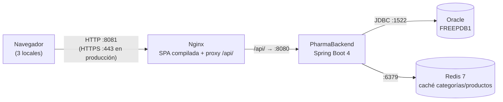

# PharmaFrontend

This project was generated using [Angular CLI](https://github.com/angular/angular-cli) version 22.2.0.

## Development server

To start a local development server, run:

```bash
ng serve
```

Once the server is running, open your browser and navigate to `http://localhost:4200/`. The application will automatically reload whenever you modify any of the source files.

## Code scaffolding

Angular CLI includes powerful code scaffolding tools. To generate a new component, run:

```bash
ng generate component component-name
```

For a complete list of available schematics (such as `components`, `directives`, or `pipes`), run:

```bash
ng generate --help
```

## Building

To build the project run:

```bash
ng build
```

This will compile your project and store the build artifacts in the `dist/` directory. By default, the production build optimizes your application for performance and speed.

## Running unit tests

To execute unit tests with the [Vitest](https://vitest.dev/) test runner, use the following command:

```bash
ng test
```

## Running end-to-end tests

For end-to-end (e2e) testing, run:

```bash
ng e2e
```

Angular CLI does not come with an end-to-end testing framework by default. You can choose one that suits your needs.

## Additional Resources

For more information on using the Angular CLI, including detailed command references, visit the [Angular CLI Overview and Command Reference](https://angular.dev/tools/cli) page.

## Despliegue en producción

### Arquitectura



| Pieza | Puerto | Expuesto a los locales | Notas |
|---|---|---|---|
| Nginx (`web` en docker-compose) | 8081 → 80 | Sí (único punto de entrada) | Sirve `dist/pharma-frontend/browser` y reenvía `/api/` |
| PharmaBackend | 8080 | No (solo Nginx) | `/actuator/health` público; resto de Actuator exige `USUARIOS_ADMINISTRAR` |
| Oracle | 1522 | No | Fuente de verdad |
| Redis | 6379 | No | Caché con TTL de 10 min; si cae, el backend sigue respondiendo desde Oracle |

### Estado de las buenas prácticas de la sesión

| Buena práctica | Estado | Acción pendiente |
|---|---|---|
| Lazy Loading de cada feature (`loadChildren`/`loadComponent`) | Cumple | — |
| Code Splitting por página y `@defer` del reporte de más vendidos | Cumple | — |
| Presupuestos de tamaño (`budgets`) y `outputHashing: all` | Cumple | — |
| Caché del navegador: `immutable` 1 año para JS/CSS, `no-cache` para `index.html` | Cumple | — |
| Compresión | Cumple parcialmente | Solo gzip; evaluar Brotli |
| Caché Redis con TTL e invalidación en cada escritura y venta | Cumple | — |
| Invalidación aplicada al confirmar la transacción (`transactionAware`) | Cumple | — |
| Degradación si Redis cae (`CacheErrorHandler`, `timeout: 500ms`) | Cumple | — |
| Logs con `requestId`, log de acceso y rotación (10 MB × 14) | Cumple | — |
| `requestId` en las respuestas de error y en los mensajes de la SPA | Cumple | — |
| Sin secretos ni DNI completos en el log | Cumple | Repetir la auditoría con `grep` tras cada versión |
| Secretos por variables de entorno en `prod` | Cumple parcialmente | `application-dev.yaml` versiona la clave de Oracle y del JWT de desarrollo: no reutilizarlas en producción |
| Health público, métricas protegidas | Cumple | — |
| HTTPS | No cumple | Certificado en Nginx (recomendación 1) |
| Copias de seguridad de Oracle | No cumple | Recomendación 2 |
| Backend en contenedor / servicio con reinicio automático | No cumple | Hoy se ejecuta con `java -jar` en la máquina anfitriona |
| Alertas sobre `/actuator/health` | No cumple | Recomendación 3 |

### Recomendaciones para los tres locales (en orden de prioridad)

1. **HTTPS en Nginx antes de abrirlo a los locales.** El token JWT viaja en cada petición; sin TLS cualquiera en la red del local puede leerlo. Certificado (Let's Encrypt o el de la empresa), redirección 80 → 443 y `Strict-Transport-Security`.
2. **Copias de seguridad diarias de Oracle y prueba de restauración.** Las migraciones de Flyway no se revierten: antes de cada despliegue, respaldo con Data Pump (`expdp`) y retención de al menos 7 días fuera del servidor.
3. **Un solo servidor central (Nginx + backend + un Redis compartido) con alertas sobre `/actuator/health`.** Un Redis por local daría stocks distintos entre locales; con uno solo, una venta invalida la caché para todos. Un monitor (Uptime Kuma o similar) consulta `/actuator/health` cada minuto y avisa si pasa a `DOWN`.


### Variables y configuración

La SPA no lee variables de entorno en tiempo de ejecución: la URL del API se fija al compilar.

| Archivo / variable | Propósito |
|---|---|
| `src/environments/environment.ts` | Producción: `apiUrl: '/api/v1'` (mismo origen, sin CORS) |
| `src/environments/environment.development.ts` | Desarrollo: `apiUrl: 'http://localhost:8080/api/v1'` |
| `deploy/nginx.conf` → `proxy_pass` | Dirección del backend (`backend:8080`) |
| `deploy/docker-compose.yml` → `extra_hosts` | `backend:host-gateway` mientras el backend corra en la máquina anfitriona |

### Construir y desplegar

```bash
git checkout <tag-de-la-version>          # p. ej. v1.3.0
npm ci
ng build                                   # configuración production por defecto
cd deploy
docker compose up -d                       # Nginx sirve ../dist/pharma-frontend/browser
docker compose ps                          # redis "healthy", web "running"
```

Nginx no necesita reiniciarse al publicar una versión nueva: `index.html` se revalida siempre y apunta a los archivos con hash nuevos; los anteriores siguen en caché del navegador hasta un año sin causar conflictos.

### Volver a la versión anterior

1. Guarda cada compilación con su versión antes de publicarla: `cp -r dist/pharma-frontend/browser releases/v1.3.0`.
2. Para revertir, copia la carpeta anterior sobre la publicada (o cambia el volumen de `web` en `docker-compose.yml` a `releases/v1.2.0`) y ejecuta `docker compose restart web`.
3. Los usuarios reciben la versión anterior en la siguiente navegación, porque `index.html` lleva `Cache-Control: no-cache`.
